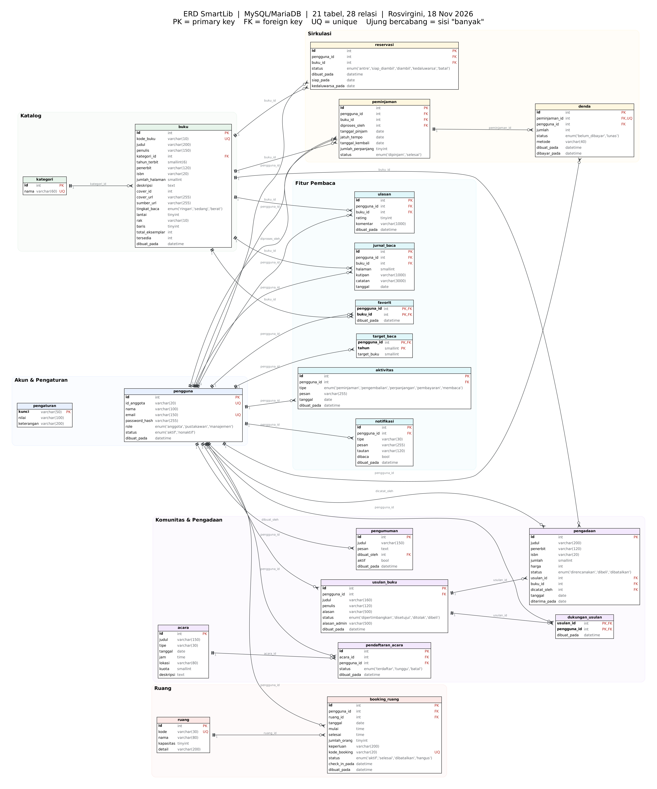

# ERD SmartLib

Dibuat dari struktur database yang benar-benar dijalankan (`database/schema.sql`), jadi gambar ini selalu sama dengan skema.

- Gambar resolusi tinggi: [ERD.png](ERD.png) · vektor (bisa di-zoom): [ERD.svg](ERD.svg)
- Versi di bawah ini tampil otomatis di GitHub (Mermaid).

```mermaid
erDiagram
    buku ||--o{ reservasi : "buku_id"
    pengguna ||--o{ reservasi : "pengguna_id"
    buku ||--o{ ulasan : "buku_id"
    pengguna ||--o{ ulasan : "pengguna_id"
    buku ||--o{ favorit : "buku_id"
    pengguna ||--o{ favorit : "pengguna_id"
    pengguna ||--o{ notifikasi : "pengguna_id"
    kategori ||--o{ buku : "kategori_id"
    acara ||--o{ pendaftaran_acara : "acara_id"
    pengguna ||--o{ pendaftaran_acara : "pengguna_id"
    pengguna ||--o{ booking_ruang : "pengguna_id"
    ruang ||--o{ booking_ruang : "ruang_id"
    pengguna ||--o{ dukungan_usulan : "pengguna_id"
    usulan_buku ||--o{ dukungan_usulan : "usulan_id"
    buku ||--o{ pengadaan : "buku_id"
    pengguna ||--o{ pengadaan : "dicatat_oleh"
    usulan_buku ||--o{ pengadaan : "usulan_id"
    pengguna ||--o{ usulan_buku : "pengguna_id"
    buku ||--o{ jurnal_baca : "buku_id"
    pengguna ||--o{ jurnal_baca : "pengguna_id"
    pengguna ||--o{ pengumuman : "dibuat_oleh"
    pengguna ||--o{ target_baca : "pengguna_id"
    buku ||--o{ peminjaman : "buku_id"
    pengguna ||--o{ peminjaman : "pengguna_id"
    pengguna ||--o{ peminjaman : "diproses_oleh"
    peminjaman ||--o{ denda : "peminjaman_id"
    pengguna ||--o{ denda : "pengguna_id"
    pengguna ||--o{ aktivitas : "pengguna_id"
    acara {
        int id PK
        varchar judul
        varchar tipe
        date tanggal
        time jam
        varchar lokasi
        smallint kuota
        text deskripsi
    }
    aktivitas {
        int id PK
        int pengguna_id FK
        enum tipe
        varchar pesan
        date tanggal
        datetime dibuat_pada
    }
    booking_ruang {
        int id PK
        int pengguna_id FK
        int ruang_id FK
        date tanggal
        time mulai
        time selesai
        tinyint jumlah_orang
        varchar keperluan
        varchar kode_booking UK
        enum status
        datetime check_in_pada
        datetime dibuat_pada
    }
    buku {
        int id PK
        varchar kode_buku UK
        varchar judul
        varchar penulis
        int kategori_id FK
        smallint tahun_terbit
        varchar penerbit
        varchar isbn
        smallint jumlah_halaman
        text deskripsi
        int cover_id
        varchar cover_url
        varchar sumber_url
        enum tingkat_baca
        tinyint lantai
        varchar rak
        tinyint baris
        int total_eksemplar
        int tersedia
        datetime dibuat_pada
    }
    denda {
        int id PK
        int peminjaman_id FK
        int pengguna_id FK
        int jumlah
        enum status
        varchar metode
        datetime dibuat_pada
        datetime dibayar_pada
    }
    dukungan_usulan {
        int usulan_id PK
        int pengguna_id PK
        datetime dibuat_pada
    }
    favorit {
        int pengguna_id PK
        int buku_id PK
        datetime dibuat_pada
    }
    jurnal_baca {
        int id PK
        int pengguna_id FK
        int buku_id FK
        smallint halaman
        varchar kutipan
        varchar catatan
        date tanggal
    }
    kategori {
        int id PK
        varchar nama UK
    }
    notifikasi {
        int id PK
        int pengguna_id FK
        varchar tipe
        varchar pesan
        varchar tautan
        tinyint dibaca
        datetime dibuat_pada
    }
    peminjaman {
        int id PK
        int pengguna_id FK
        int buku_id FK
        int diproses_oleh FK
        date tanggal_pinjam
        date jatuh_tempo
        date tanggal_kembali
        tinyint jumlah_perpanjang
        enum status
    }
    pendaftaran_acara {
        int id PK
        int acara_id FK
        int pengguna_id FK
        enum status
        datetime dibuat_pada
    }
    pengadaan {
        int id PK
        varchar judul
        varchar penerbit
        varchar isbn
        smallint jumlah
        int harga
        enum status
        int usulan_id FK
        int buku_id FK
        int dicatat_oleh FK
        date tanggal
        date diterima_pada
    }
    pengaturan {
        varchar kunci PK
        varchar nilai
        varchar keterangan
    }
    pengguna {
        int id PK
        varchar id_anggota UK
        varchar nama
        varchar email UK
        varchar password_hash
        enum role
        enum status
        datetime dibuat_pada
    }
    pengumuman {
        int id PK
        varchar judul
        text pesan
        int dibuat_oleh FK
        tinyint aktif
        datetime dibuat_pada
    }
    reservasi {
        int id PK
        int pengguna_id FK
        int buku_id FK
        enum status
        datetime dibuat_pada
        date siap_pada
        date kedaluwarsa_pada
    }
    ruang {
        int id PK
        varchar kode UK
        varchar nama
        tinyint kapasitas
        varchar detail
    }
    target_baca {
        int pengguna_id PK
        smallint tahun PK
        smallint target_buku
    }
    ulasan {
        int id PK
        int pengguna_id FK
        int buku_id FK
        tinyint rating
        varchar komentar
        datetime dibuat_pada
    }
    usulan_buku {
        int id PK
        int pengguna_id FK
        varchar judul
        varchar penulis
        varchar alasan
        enum status
        varchar alasan_admin
        datetime dibuat_pada
    }
```

